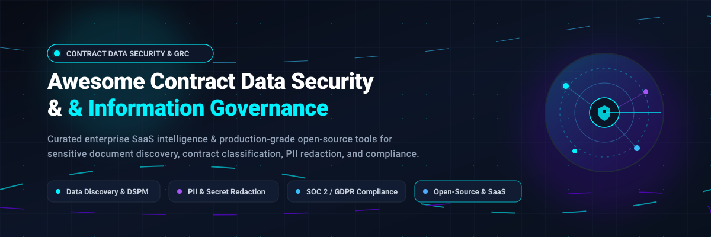

# Awesome Contract Data Security & Information Governance 🛡️💼

  

  
  
  
  
  

A curated directory of top-tier enterprise SaaS platforms and battle-tested open-source projects for **Contract Data Security**, **Information Governance**, **Sensitive Data Discovery**, and **Regulatory Compliance**. 🚀

Whether you are managing contract lifecycle security, classifying sensitive PII/IP across enterprise data stores, or implementing automated compliance controls (SOC 2, ISO 27001, HIPAA, GDPR), this repository catalogs industry-standard solutions across commercial SaaS and self-hosted open-source software. 🔐

---

## 📑 Table of Contents
- [📊 Sector Overview & Market Dynamics](#-sector-overview--market-dynamics)
- [🏢 Enterprise SaaS Platforms](#-enterprise-saas-platforms)
- [💻 Open-Source Governance & Security Projects](#-open-source-governance--security-projects)
- [🏗️ Architecture & Governance Blueprint](#️-architecture--governance-blueprint)
- [🤝 How to Contribute](#-how-to-contribute)
- [💖 Support](#-support)
- [⭐ Star History](#-star-history)
- [⚠️ Disclaimer](#️-disclaimer)

---

## 📊 Sector Overview & Market Dynamics

The global **Data Security** and **Information Governance** market is valued at approximately **$37.5B–$42B combined** (with Data Security representing ~$32.9B growing at ~11.4% CAGR, and Information Governance representing ~$5.2B expanding at ~16–21% CAGR toward $15B+ by the early 2030s). 📈

The sector exhibits a **hybrid, barbell market concentration**:
- 🏢 **Moderately Concentrated Core:** Foundational enterprise infrastructure, cloud identity, and unified compliance map platforms are concentrated among legacy tech titans and cyber resilience giants (e.g., Microsoft, CyberArk / Palo Alto Networks, Rubrik).
- 🧩 **Highly Fragmented Edge:** The specialized layers—encompassing automated contract intelligence, sensitive PII/secret discovery, AI safety governance, and open-source data cataloging—remain highly fragmented among fast-moving venture-backed unicorns and community-led open-source frameworks addressing specific data sovereignty and audit requirements.

---

## 🏢 Enterprise SaaS Platforms

Below is a curated comparison of leading SaaS platforms for contract data security, governance, and compliance. Table is sorted descending by company scale (Valuation / Enterprise Revenue). 💼

| Product | Scale (Valuation / Revenue) | Description | Pricing (Starting Tier) | Free Tier / Trial Limits |
|:---|:---|:---|:---|:---|
| **[Microsoft Purview](https://www.microsoft.com/en-us/security/business/microsoft-purview)** | **$3.0T+** Market Cap / **$245B+** Revenue | Comprehensive data governance, compliance risk management, and sensitive document classification suite spanning Microsoft 365, Azure, AWS, and multicloud environments. | **$0.0165 / unique asset / day** on Azure pay-as-you-go Data Map; or bundled with Microsoft 365 E5 compliance add-ons starting at **$12.00 / user / month**. | **90-day free trial** of Purview Compliance suite (includes 25 user licenses); Azure tier offers **30-day / $200 free credit** with free Data Map scanning without Unified Catalog. |
| **[CyberArk](https://www.cyberark.com/)** | **$25.0B** Acq. Valuation / **$1.3B+** Revenue | Identity security and privileged access management (PAM) platform securing privileged contract access, credential vaults, and confidential administrative sessions. | Privileged Standard user subscription starts at **$95.75 / user / year** (via authorized marketplace/CDW). | **30-day proof-of-concept (PoC) trial** arranged via sales/partner engineering (limited to ~10–25 test users and safe vaults; no self-serve free forever plan). |
| **[Rubrik](https://www.rubrik.com/)** | **$12.0B+** Market Cap / **$1.54B** Revenue | Zero-trust data security and cyber resilience platform offering ransomware protection, automated data discovery, and compliance auditing for sensitive document archives. | Scale Foundation starts at **$156,000 / year** (100 BETB backup/governance tier; 3-year commitment standard). | **30 to 60-day structured PoC trial** via sales or AWS Marketplace Private Offer (capped capacity in FETB/protected workloads; infrastructure costs apply). |
| **[Collibra](https://www.collibra.com/)** | **$5.25B** Valuation / **$100M+** ARR | Enterprise data intelligence cloud providing data cataloging, lineage tracking, contract metadata stewardship, and automated data quality monitoring. | Data Quality & Observability package starts at **$150,000 / year** (10 named users, up to 1,000 tracked tables). | **No self-serve free plan**; guided interactive product tours available online; sales-assisted technical PoC sandboxes provided for vetted enterprise deals. |
| **[Icertis](https://www.icertis.com/)** | **$5.0B** Valuation / **$350M+** ARR | AI-powered enterprise Contract Intelligence (CLM) platform with granular role-based governance, sensitive clause classification, and audit compliance enforcement. | Custom enterprise quotes; typical mid-enterprise commitments start around **$50,000–$100,000 / year** based on volume of active contract documents. | **No self-serve free plan or free trial**; evaluation is conducted via vendor-led demonstrations and scoped pilot agreements. |
| **[OneTrust](https://www.onetrust.com/)** | **$4.5B** Valuation / **$550M+** ARR | Trust intelligence and privacy management platform automating contract vendor risk assessments, data mapping, consent enforcement, and regulatory audits. | Privacy Essentials Suite starts at **$3,680 / month**; Single-domain CMP starts at **$827 / month** (median annual contract ~$10,514 / year). | **14-day free trial** of Trust Intelligence platform modules available upon registration (sales-coordinated onboarding; no perpetual free tier). |
| **[Vanta](https://www.vanta.com/)** | **$4.2B** Valuation / **$300M+** ARR | Automated compliance and audit evidence platform integrating with cloud apps and contract stores for continuous SOC 2, ISO 27001, and HIPAA control verification. | Essentials tier starts at **$7,500 / year** (covers 1 framework for teams under 20 employees; AWS Marketplace listed); Plus tier starts at **$21,500 / year**. | **No self-serve free tier**; 7 to 14-day sales-guided sandbox trial available following an introductory technical demo (external CPA audit fee not included). |
| **[Securiti.ai](https://securiti.ai/)** | **$1.73B** Acq. Valuation / **$300M** Run-Rate | Unified Data Command Center automating sensitive data discovery, DSPM (Data Security Posture Management), contract privacy rights, and AI governance. | Subscription pricing scales with protected connectors/data volume, with enterprise entry tiers typically starting at **$25,000 / year**. | **14-day structured Data Discovery Assessment trial** available through certified deployment partners (covers targeted cloud/unstructured stores). |
| **[Egnyte](https://www.egnyte.com/)** | **$1.5B** Valuation / **$250M+** ARR | Cloud content governance platform with native contract lifecycle management, automated PII/classification scanning, access permissions, and ransomware safeguards. | Enterprise Lite tier starts at **$11,838.75 / year** (annual term, includes 25 users and 2 TB secure storage); standard Business tier starts at **$20.00 / user / month**. | **15-day free trial** with no credit card required upfront (standard trial limited to 10 test users, 20 GB storage capacity, and Business plan features). |
| **[BigID](https://bigid.com/)** | **$1.0B+** Valuation / **$100M+** ARR | ML-driven data discovery and classification engine cataloging sensitive contract assets, regulatory identifiers, and intellectual property across 100+ stores. | C4 Foundation Package starts at **$525,000** (one-time base over a 3-year term for >100 connected data sources); Purview MPIP integration adds **$35,000 / year**. | **No public freemium plan**; tailored sales-led Proof-of-Concept assessments or BigID Express pilots offered for qualified enterprise environments. |

---

## 💻 Open-Source Governance & Security Projects

A comprehensive collection of active, production-grade open-source tools for self-hosted data discovery, document archiving, metadata management, secret detection, and contract data classification. 🛠️

Sorted descending by GitHub stars:

| Project | Stars | License | Primary Focus | Description |
|:---|:---:|:---:|:---|:---|
| **[Paperless-ngx](https://github.com/paperless-ngx/paperless-ngx)** |  | GPL-3.0 | Document Archiving & OCR | Community-driven document management system that transforms physical and digital contracts into searchable, indexed archives with OCR, tag classification, and metadata extraction. |
| **[TruffleHog](https://github.com/trufflesecurity/trufflehog)** |  | AGPL-3.0 | Secret & Credential Scanning | High-performance scanner that detects exposed API keys, private certificates, passwords, and sensitive credentials buried inside codebases, contract repositories, and file storage. |
| **[OpenMetadata](https://github.com/open-metadata/OpenMetadata)** |  | Apache-2.0 | Metadata Management & Governance | Complete metadata architecture supporting unified data discovery, end-to-end data lineage, automated PII auto-tagging, column-level classification, and governance team workflows. |
| **[Documenso](https://github.com/documenso/documenso)** |  | AGPL-3.0 | Digital Signatures & Contract Workflows | Open-source alternative to DocuSign. Provides self-hostable digital document signing, tamper-evident cryptographic audit logs, and secure contract lifecycle management. |
| **[DataHub](https://github.com/datahub-project/datahub)** |  | Apache-2.0 | Metadata Catalog & Lineage | Originally created by LinkedIn, DataHub delivers a real-time metadata platform with GraphQL APIs, governance assertions, automated schema tracking, and dataset classification. |
| **[Great Expectations](https://github.com/great-expectations/great_expectations)** |  | Apache-2.0 | Data Quality & Rule Validation | Python-based validation framework enabling teams to test, document, and monitor data quality. Validates contract metadata pipelines and enforces governance rules as code. |
| **[Microsoft Presidio](https://github.com/microsoft/presidio)** |  | MIT | PII Detection & Anonymization | Context-aware PII detection and de-identification engine using NLP and regex to recognize and redact confidential identifiers (names, SSNs, bank details) across legal agreements. |
| **[Amundsen](https://github.com/amundsen-io/amundsen)** |  | Apache-2.0 | Data Discovery Engine | Lyft's open-source data discovery engine powered by a PageRank-style search algorithm for data assets, team ownership mapping, and compliance tagging. |
| **[Apache Atlas](https://github.com/apache/atlas)** |  | Apache-2.0 | Enterprise Metadata & Classification | Scalable enterprise governance framework providing business taxonomies, classification propagation, and audit-ready lineage for enterprise Hadoop and cloud data lakes. |
| **[Apache Ranger](https://github.com/apache/ranger)** |  | Apache-2.0 | Security & Access Control Policy | Comprehensive data security framework for centralized authorization, fine-grained access control (row/column filtering), and audit logging across enterprise storage. |

---

## 🏗️ Architecture & Governance Blueprint

Organizations managing sensitive commercial agreements can assemble a robust, self-hosted governance and security stack using open-source tools: 🧩

1. 📥 **Document Storage & Ingestion:** Deploy **[Paperless-ngx](https://github.com/paperless-ngx/paperless-ngx)** to ingest, OCR, and index contract repositories.
2. 🔍 **Sensitive Data Redaction & Classification:** Run **[Microsoft Presidio](https://github.com/microsoft/presidio)** over extracted document text to identify PII, financial details, and sensitive legal entities.
3. 🔑 **Secret & Key Leak Prevention:** Execute **[TruffleHog](https://github.com/trufflesecurity/trufflehog)** automated scans to safeguard contract directories against hardcoded API tokens or credentials.
4. 🗺️ **Metadata Cataloging & Lineage:** Feed parsed contract metadata into **[OpenMetadata](https://github.com/open-metadata/OpenMetadata)** or **[DataHub](https://github.com/datahub-project/datahub)** to track data provenance, ownership, and regulatory tags.
5. ✅ **Quality Verification & Access Enforcement:** Apply **[Great Expectations](https://github.com/great-expectations/great_expectations)** for contract pipeline test suites and **[Apache Ranger](https://github.com/apache/ranger)** to enforce role-based access control.

---

## 🤝 How to Contribute

We welcome contributions from legal ops engineers, compliance officers, security architects, and open-source maintainers! ✨

1. 🍴 **Fork the Repository** on GitHub.
2. 🌿 **Create a Feature Branch** (`git checkout -b feature/add-new-tool`).
3. 📝 **Add or Update Entries** in `README.md` following our standard tabular format:
   - For SaaS products: Include official links, realistic starting tier pricing, explicit free trial / plan limitations, and company scale metrics.
   - For Open-Source projects: Include valid GitHub links, real-time star badge (`style=social&color=white`), license, and practical governance use case.
4. 💾 **Commit & Push** (`git commit -m "feat: add [Tool Name]" && git push origin feature/add-new-tool`).
5. 🚀 **Open a Pull Request** with a brief summary of the changes.

---

## 💖 Support

Thank you for visiting and using this repository! If you find this curated ecosystem helpful:
- ⭐ **Star** this repository on GitHub to help others discover it.
- 🍴 **Fork** and contribute entries or improvements.
- 📢 **Share** it with your network, team, and security community.
- ☕ **Buy me a coffee / Sponsor:** If you'd like to support the ongoing maintenance and curation of open-source security lists, consider sponsoring via the [GitHub Sponsors Dashboard](https://github.com/sponsors/ishandutta2007).

---

## 📈 Star History

---

## ⚠️ Disclaimer

- This curated list is maintained for informational and educational purposes. Inclusion does not imply official endorsement or sponsorship.
- Contract documents routinely contain sensitive commercial trade secrets, proprietary intellectual property, and personal data (PII). Ensure your organization implements end-to-end encryption, strict role-based access controls, and compliance with GDPR, CCPA/CPRA, and relevant sector-specific regulatory standards.
- Pricing metrics and trial terms are compiled from vendor public documentation, cloud marketplaces (AWS / Azure), and enterprise procurement benchmarks; actual terms may vary based on deployment scale and negotiated enterprise terms.
